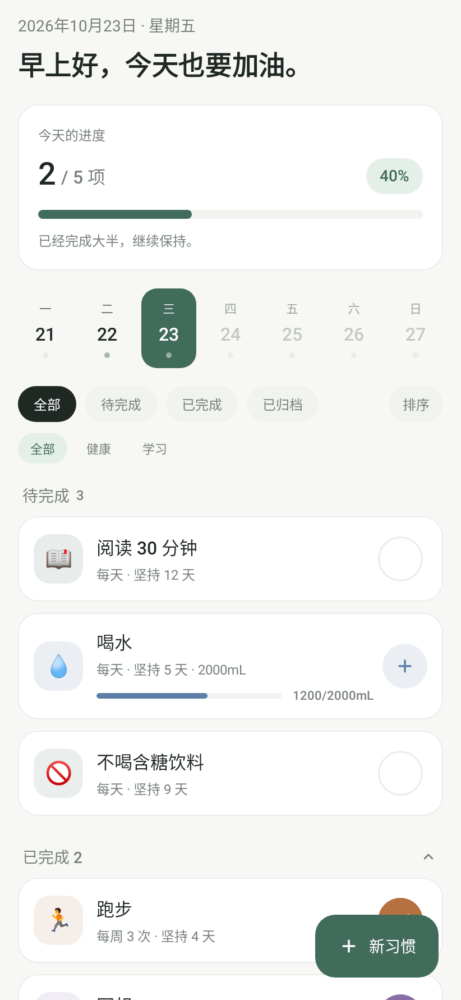
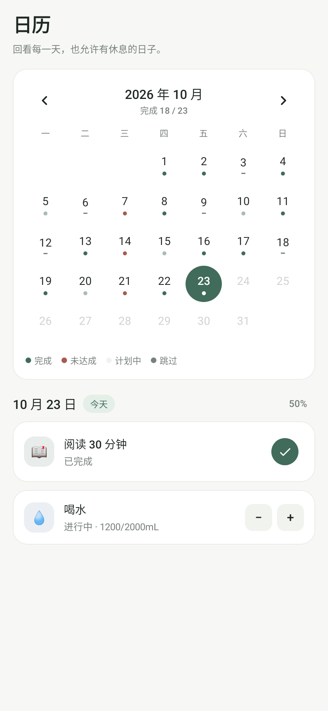
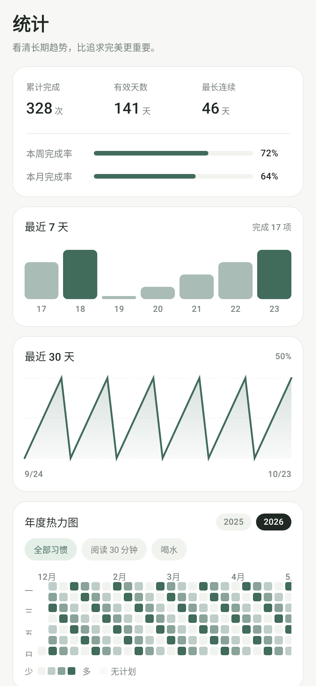
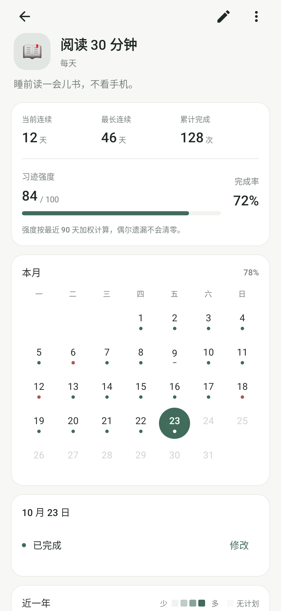

# 习迹 · 每一点坚持，都算数

一款完全离线的 Android 原生习惯打卡应用。Kotlin + Jetpack Compose + Material 3 + Room + DataStore + Glance。

**不联网、不登录、无广告、无埋点、无云同步。** 所有数据只保存在设备本地，且明确禁用系统自动云备份。

[下载流畅测试版](https://github.com/ggbo13/Xiji/releases/latest) · [性能优化与验证记录](PERFORMANCE_REPORT.md)

本版针对页面滚动与拖动排序优化：修复排序时整列卡片一起位移，把统计计算移到后台，并减少历史记录的重复扫描和动画布局开销。121 项自动化测试通过，尚未测量真机帧率。

| 今日 | 日历 | 统计 | 详情 |
|---|---|---|---|
|  |  |  |  |

---

## 1. 快速开始

### 直接安装 APK

从 [Releases](https://github.com/ggbo13/Xiji/releases/latest) 下载 `Xiji-smooth-1.4.0.apk`，在手机上安装，或使用：

```bash
adb install Xiji-smooth-1.4.0.apk
```

- 测试版包名：`com.xiji.habits.smooth`，名称为“习迹·流畅测试”，采用 release 配置并关闭调试模式
- 测试版与原版共存；需要使用现有习惯时，可在原版导出备份后，在测试版导入
- 最低 Android 8.0（API 26），target SDK 35
- 首次启动不需要任何账号或网络

### 从源码构建

需要 JDK 17 或 21 与 Android SDK Platform 35。首次构建需联网下载 Gradle、Android 构建工具及依赖；应用运行时完全离线。

```bash
# 1. 指定 SDK 路径（或在 Android Studio 中直接打开项目）
echo "sdk.dir=/path/to/Android/Sdk" > local.properties

# 2. 构建 Debug APK（首次会下载 Gradle 8.11.1 与依赖）
./gradlew :app:assembleDebug
# 产物：app/build/outputs/apk/debug/app-debug.apk

# 3. 运行单元测试（121 项）
./gradlew :app:testDebugUnitTest

# 4. 生成界面截图（Robolectric 原生渲染）
./gradlew :app:testDebugUnitTest --tests "com.xiji.habits.ui.*"
# 产物：app/build/screenshots/*.png

# 5. 构建可共存的流畅测试版（使用本机调试证书签名）
./gradlew :app:assembleSmooth
# 产物：app/build/outputs/apk/smooth/app-smooth.apk

# 6. Android 静态检查
./gradlew :app:lintDebug
```

用 Android Studio 打开时，选择 `Xiji` 根目录即可，无需额外配置。
Windows PowerShell 下将 `./gradlew` 替换为 `.\gradlew.bat`。

### Release 构建与签名

正式签名密钥由开发者自行管理，**不要提交到仓库**。在项目根目录创建 `keystore.properties`：

```properties
storeFile=../keystore/xiji-release.jks
storePassword=******
keyAlias=xiji
keyPassword=******
```

然后：

```bash
./gradlew :app:assembleRelease
# 产物：app/build/outputs/apk/release/app-release.apk
```

若不存在 `keystore.properties`，release 构建会产出**未签名** APK（`app-release-unsigned.apk`），
需要用 `apksigner` 手动签名后才能安装。

> 说明：release 默认关闭 R8 代码压缩（`isMinifyEnabled = false`）。原因见「已知问题与限制」。
> 如需开启，把 `app/build.gradle.kts` 中的 `isMinifyEnabled` 改为 `true` 并验证 Room / Glance / kotlinx.serialization 的反射路径。

---

## 2. 功能

**今日**：日期问候、今日进度摘要、七日日期条、待完成/已完成分组、分类与状态筛选、快捷打卡、数量快捷记录、
长按操作面板、排序模式拖拽、打卡撤销。

**排序**：点「排序」进入排序模式，按住卡片右侧把手上下拖动——被拖起的卡片会跟随手指并抬起阴影，
其余卡片用弹簧动画让位，每越过一格有一次轻震动反馈，松手后残余位移自动归位并一次性写入新顺序。
靠近列表上下边缘时会自动缓慢滚动，长列表也能拖到底。排序只作用于「待完成」分组，
已完成的行保持原样。TalkBack 用户可用把手上的「上移 / 下移」自定义操作完成同样的调整。

**习惯**：三种类型（完成型 / 数量型 / 戒除型）、四种周期（每天 / 指定星期 / 每周 N 次 / 每隔 N 天）、
自定义图标与颜色、分类、多提醒、暂停 / 恢复 / 归档 / 删除。

**日历**：月历（完成 / 未达成 / 计划中 / 跳过 / 暂停 五种标记）、日期详情、历史补记与备注。

**补签**：在今日页选中过去日期、或在日历页开启「补签模式」，即可把漏记的日子补记为已完成；
支持单个补签与「全部补签」，可附加备注。补签会写入 `isBackfilled` 标记，在日历、今日列表、
详情历史中显示为「补签」标签。补签**不提供任何额外奖励**，也不改变连续与完成率的计算口径——
它只是把已经发生的事实记下来。未来日期与暂停日会被拒绝。

**统计**：累计完成、有效天数、最长连续、周/月完成率、7 天柱状图、30 天折线图、
年度热力图（按年份与习惯切换、可点选日期）、各习惯完成率、习迹强度（0–100）。

**提醒**：多时间、按星期、单独开关；AlarmManager 精确闹钟；已完成 / 暂停 / 归档不提醒；
重启、改时间、改时区、更新 APK 后自动恢复。

**桌面小组件**：2×2 今日进度、4×2 今日列表。两种组件都支持操作**全部三种习惯类型**：
完成型点「完成」，数量型点「+1」（可叠加，达到目标自动完成），戒除型点「守住」/「重来」。
点习惯名称进入详情页（精确修改数量用）。行数按组件真实尺寸自适应，深浅色跟随系统。
所有数据写操作（新建/编辑/删除/打卡/补签/排序/暂停/删除分类/导入）都会在 400ms 内自动刷新组件，
回到 App 前台时也会刷新一次。

**数据**：JSON 完整备份 / 恢复（带版本校验、预览、合并或替换、事务回滚）、CSV 导出。

---

## 3. 隐私设计

这是本项目的第一优先级约束，落实到构建配置而非仅仅文档承诺：

| 措施 | 实现位置 |
|---|---|
| 不申请 `INTERNET` 权限 | `AndroidManifest.xml`，并用 `tools:node="remove"` 兜底移除依赖可能带入的 `INTERNET` / `ACCESS_NETWORK_STATE` |
| 无网络库 / 统计 SDK / 崩溃上报 | `app/build.gradle.kts` 依赖清单，仅 AndroidX + Kotlin 协程 + kotlinx.serialization |
| 禁止系统云备份 | `android:allowBackup="false"` + `dataExtractionRules`（Android 12+）+ `backup_rules.xml`（API ≤ 30），全部域排除 |
| 禁止明文流量 | `usesCleartextTraffic="false"` + `networkSecurityConfig` |
| 数据只在本地 | Room（`xiji.db`）+ DataStore，均在应用私有目录 |
| 唯一的对外数据通道 | 用户主动触发的 SAF 导出 |

**已实际验证**：用 `aapt2 dump permissions` 检查构建产物，权限只有
`POST_NOTIFICATIONS`、`RECEIVE_BOOT_COMPLETED`、`SCHEDULE_EXACT_ALARM`、`USE_EXACT_ALARM`、`VIBRATE`
（以及 Glance 传递依赖带来的 `WAKE_LOCK`、`FOREGROUND_SERVICE`，见「已知限制」）。**没有 `INTERNET`**。

如果导出时选择了云盘目录，同步行为由该文件提供方（系统文件管理器 / 网盘 App）负责，
习迹自身不发起任何网络请求。

---

## 4. 项目文档

| 文档 | 内容 |
|---|---|
| [`REFERENCE_ANALYSIS.md`](REFERENCE_ANALYSIS.md) | 5 个参考项目的许可证核查、优缺点、吸收与重新设计 |
| [`PLAN.md`](PLAN.md) | 阶段计划、功能完成清单、关键设计决策 |
| [`ARCHITECTURE.md`](ARCHITECTURE.md) | 分层、目录、状态管理、提醒链路、备份事务 |
| [`DATA_MODEL.md`](DATA_MODEL.md) | 表结构、索引、状态推导、统计口径、强度算法、迁移策略 |
| [`UI_SPEC.md`](UI_SPEC.md) | 色彩、排版、间距、组件、动效、无障碍 |
| [`TEST_REPORT.md`](TEST_REPORT.md) | 真实测试结果与构建记录 |

---

## 5. 技术栈

| 项 | 选择 | 版本 |
|---|---|---|
| 语言 | Kotlin | 2.0.21 |
| UI | Jetpack Compose + Material 3 | BOM 2024.12.01 |
| 数据库 | Room（KSP） | 2.6.1 |
| 偏好 | DataStore Preferences | 1.1.1 |
| 导航 | Navigation Compose | 2.8.5 |
| 小组件 | Glance AppWidget | 1.1.1 |
| 序列化 | kotlinx.serialization | 1.7.3 |
| 构建 | AGP 8.7.3 / Gradle 8.11.1 / JDK 17 | |
| 测试 | JUnit4 + Robolectric 4.14.1 | |

没有引入 Hilt：依赖图只有 4 个对象，显式 `AppContainer` 更易读，也省掉注解处理时间。

---

## 6. 已知问题与限制

1. **尚未完成真机 / 模拟器验证。** 当前已通过 Gradle 构建 APK、121 项 JVM/Robolectric 单元测试和原生图形渲染测试。
   首次真机安装时请重点检查：通知权限弹窗、精确闹钟授权、小组件添加、中文输入法下的编辑页。
2. **Glance 传递依赖会引入 WorkManager。** `androidx.glance:glance:1.1.1` 硬依赖 `androidx.work:work-runtime`，
   Gradle 无法排除（已在依赖树中确认）。因此合并后的 Manifest 会带上 `WAKE_LOCK` 与 `FOREGROUND_SERVICE`。
   本应用**不调用** WorkManager，也不会创建它的数据库，但这两个权限确实存在于 APK 中。
   如果对权限清单有极致要求，可选方案是移除小组件（阶段六功能）。
3. **release 未开启 R8。** 当前发布保留项目原有配置，默认关闭代码及资源压缩。开启方式见上文，开启后需重新验证。
4. **数据库已升级到 v2**（新增 `records.isBackfilled`）。v1→v2 使用 `ALTER TABLE ADD COLUMN`，
   有迁移测试覆盖；从旧版本升级不会丢失任何记录。

5. **戒除型的「未记录」语义。** 未记录显示为「未记录」，在完成率分母中按未完成计算（不会自动算成功）。
   如果希望「未记录不计入分母」，需要修改 `StatisticsEngine.habitStats` 的分母规则。
6. **每周 N 次的月完成率**按「本月已过周数 × N」估算，跨月的周会同时计入两个月，可能与直觉略有差异。
7. **多语言**目前只有简体中文与英文的少量字符串（应用名、小组件描述）。
   所有界面文案直接写在 Compose 代码里，架构上可迁移到 `strings.xml`，但尚未完成。
8. **未实现（P2）**：加密备份、应用锁、习惯模板、更细的提醒控制、完整多语言。
9. **数据库版本为 2。** `ALL_MIGRATIONS` 目前只有 `MIGRATION_1_2`；后续版本必须继续追加。
10. **补签不设次数上限**，也不提供任何补签奖励。补签会正常计入完成率与连续（因为它记录的是真实发生的事），
   但会带 `isBackfilled` 标记以便区分。如果希望补签不计入统计，需要调整 `StatisticsEngine` 的口径。
11. **小组件内的数量型操作固定为 +1**。精确修改数值（例如今天喝了 250mL）需要点名称进 App 操作。
    这是刻意的取舍：组件内不弹输入框，保持一步打卡。

12. **删除分类只会解除关联**，习惯与打卡记录全部保留；已归档习惯在「已归档」筛选里查看。
13. **排序只覆盖「待完成」分组**，不能把习惯拖到「已完成」分组里（那由打卡状态决定，不由顺序决定）。
14. **尚未进行真机帧率基准测试。** 固定样本的统计全表读取次数从 37,200 降到 1,800；该指标不代表帧率或耗时提升比例。详见 [性能报告](PERFORMANCE_REPORT.md)。

---

## 7. 目录速览

```
Xiji/
├── app/src/main/java/com/xiji/habits/
│   ├── data/          Room + DataStore + Repository
│   ├── domain/        纯 Kotlin：模型、周期引擎、统计引擎
│   ├── ui/            Compose 页面、组件、主题
│   ├── reminder/      AlarmManager 调度与通知
│   ├── backup/        JSON/CSV 导入导出
│   └── widget/        Glance 小组件
├── app/src/test/      121 项单元测试
├── app/schemas/       Room schema 导出
└── docs/              设计文档与截图
```

## 8. 许可证

当前仓库尚未指定开源许可证，公开展示源码不代表已授予复用、修改或分发许可。依赖与参考资料的说明见 [参考项目调研](REFERENCE_ANALYSIS.md)。
